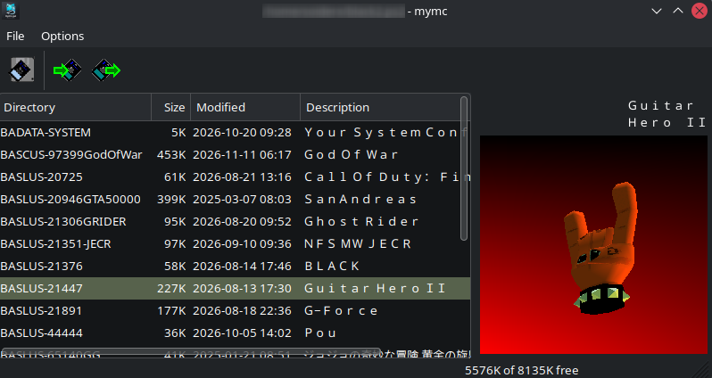
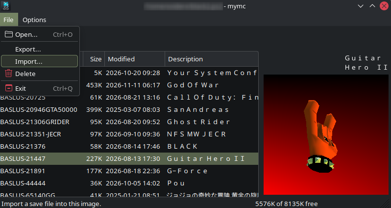
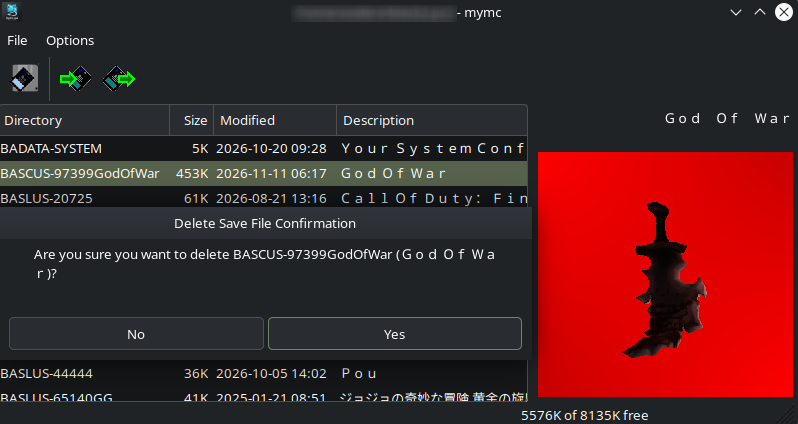
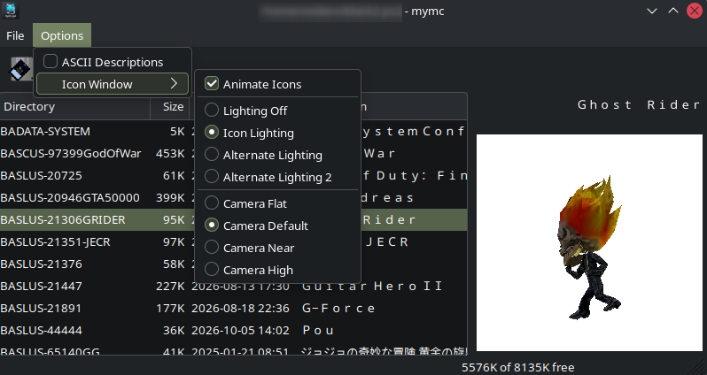

# PS2 Memory Card Manager (mymc for Python 3)

*[Leer en español](README.es.md)*

A gui tool for Linux, macOS and Windows to manage **PlayStation 2 memory card images** like the ones the
PCSX2 emulator uses (`Mcd001.ps2`). It imports and exports save games, and
it can also create, inspect and check card images.

This is a port of Ross Ridge's **mymc 2.7** from Python 2 to **Python 3**,
with a working graphical interface on wxPython 4 and a new cross-platform
3D save icon viewer.

 

## Features

- **GUI**: open a card, browse its saves (with Japanese titles), import,
  export and delete saves, and view each save's animated **3D icon**.
- **Command line**: every operation, plus advanced ones (add/extract
  individual files, mkdir, rename, change mode flags, file system check,
  format new cards).
- **Save formats**

  | Format | Extension | Import | Export |
  |---|---|:---:|:---:|
  | EMS / uLaunchELF | `.psu` | ✅ | ✅ |
  | MAX Drive | `.max` | ✅ | ✅ |
  | CodeBreaker | `.cbs` | ✅ | — |
  | SharkPort / X-Port | `.sps` `.xps` | ✅ | — |

- Card images with or without ECC data. Single-bit errors are corrected
  automatically.
  
  <p align="center">
    
    
    
    
  </p>

  
  ## Usage

### Graphical interface

```sh
./mymc-gui                    # asks which card image to open
./mymc-gui ~/.config/PCSX2/memcards/Mcd001.ps2
```
Running `./mymc.py` with no arguments also starts the GUI.

- **Open**: choose a `.ps2` card image.
- **Import**: add one or more save files (`.psu .max .cbs .sps .xps`).
- **Export**: select saves and export them as `.psu` or `.max`.
- **File → Delete**: remove the selected saves.
- Select a save to see its 3D icon. **Right-click the icon** (or use
  *Options → Icon Window*) to change animation, lighting and camera.
- *Options → ASCII Descriptions* shows titles as plain ASCII.

> ⚠️ **Don't modify a card image while PCSX2 is running.** Close the
> emulator first or the card may get corrupted. Back up your card images
> before you use any tool on them.

### Command line

```
./mymc.py [-i] memcard.ps2 command [options] [arguments]
```

| Command | Description |
|---|---|
| `dir` | List saves with their titles and sizes, plus free space |
| `ls [dir]` | List the files in a directory |
| `import save...` | Import save files |
| `export [-m\|-p] [-l] dir...` | Export saves (`-p` .psu default, `-m` .max, `-l` long descriptive names) |
| `delete dir...` | Delete a save (recursively) |
| `add`, `extract`, `mkdir`, `remove`, `rename` | Work with individual files |
| `set`, `clear` | Change mode flags (protected, hidden, …) |
| `check` | Check the file system for errors |
| `df` | Show free space |
| `format [-e] [-c clusters]` | Create a new card image (`-e`: without ECC) |
| `gui` | Open the GUI on this card |

Run `./mymc.py --help` or `./mymc.py card.ps2 COMMAND --help` for details.

Examples:
```sh
./mymc.py Mcd001.ps2 dir
./mymc.py Mcd001.ps2 import "Some Game.psu"
./mymc.py Mcd001.ps2 export -l BASLUS-12345GAME
./mymc.py new.ps2 format
```

## Optional: menu entry (Linux)

To add mymc to your desktop's application menu, create
`~/.local/share/applications/mymc.desktop` and replace the paths with
the folder where you cloned the repository:
```ini
[Desktop Entry]
Type=Application
Name=mymc
Comment=PS2 memory card manager
Exec=/path/to/mymc/mymc-gui %f
Terminal=false
Categories=Utility;Game;
```

## Requirements

| Component | Needed for | Required? |
|---|---|---|
| **Python 3.8+** | everything | yes |
| **wxPython 4.x** | the graphical interface | GUI only |
| **numpy** | 3D icons in the GUI | optional |

The command line tool runs on plain Python with no extra packages.
Without wxPython only the command line is available. Without numpy the
GUI still works but doesn't show the icons.

> Tested with Python 3.14, wxPython 4.2.4 (GTK3) and numpy 2.x on Fedora 44.

## Installation

### 1. Install the dependencies

Use your distribution's packages. They are the easiest option, because
wxPython ships no prebuilt Linux wheels on PyPI. Package names can differ slightly between releases of each distribution.

**Fedora / RHEL / CentOS Stream / AlmaLinux / Rocky** (EPEL may be needed on RHEL clones)
```sh
sudo dnf install python3 python3-wxpython4 python3-numpy
```

**Debian / Ubuntu / Linux Mint / Pop!_OS**
```sh
sudo apt install python3 python3-wxgtk4.0 python3-numpy
```

**Arch Linux / Manjaro / EndeavourOS**
```sh
sudo pacman -S python python-wxpython python-numpy
```

**openSUSE Tumbleweed / Leap**
```sh
sudo zypper install python3 python3-wxPython python3-numpy
```

**Gentoo**
```sh
sudo emerge --ask dev-python/wxpython dev-python/numpy
```

**Void Linux**
```sh
sudo xbps-install python3 python3-wxPython python3-numpy
```

**Alpine Linux**
```sh
sudo apk add python3 py3-wxpython py3-numpy
```

**NixOS / Nix** (temporary shell)
```sh
nix-shell -p "python3.withPackages (ps: [ ps.wxpython ps.numpy ])"
```

**Any distribution with pip (virtual environment)**

On Linux, `pip install wxPython` compiles from source. That takes a
long time and needs a C++ compiler plus the GTK3 development headers.
Prebuilt wheels for common distributions are on
<https://extras.wxpython.org/wxPython4/extras/linux/>.
```sh
python3 -m venv venv
. venv/bin/activate
# Example using a prebuilt wheel (pick the folder for your distro):
pip install -f https://extras.wxpython.org/wxPython4/extras/linux/gtk3/ubuntu-24.04 wxPython
pip install numpy
```

**Windows / macOS** (untested with this port)
```sh
pip install wxPython numpy
```

### 2. Get mymc

```sh
git clone https://github.com/soiderxus/ps2-memcard-manager.git
cd ps2-memcard-manager
chmod +x mymc.py mymc-gui
```

No build step is needed. Keep all the `.py` files together in one directory.

### Check the installation

```sh
python3 -c "import wx; print('wxPython', wx.version())"
python3 -c "import numpy; print('numpy', numpy.__version__)"
./mymc.py --version
```

## Changes from the original 2.7

- Ported to Python 3: card data is handled as `bytes`, and file names on
  the card are kept losslessly.
- GUI ported to wxPython 4 (Phoenix).
- **New `ps2icon.py`**: a portable 3D icon viewer (numpy software
  renderer). It replaces the Windows-only Direct3D DLL.
- Removed the Windows-only native helper DLLs (`mymcsup`, `mymcicon`).
  The pure Python code is always used.
- When exporting from the GUI, the `.psu` / `.max` extension now follows
  the selected file type.
- Bugs from 2.7 fixed:
  - `format -e` (no ECC) created images of the wrong size
  - `readline()` on files inside the card returned the wrong length
  - `extract -o FILE` never closed the output file
  - `dir` crashed on PlayStation/PocketStation saves
  - several error paths used undefined names

### Known limitations

- Saves in the CodeBreaker and SharkPort/X-Port formats can be imported
  but not exported (same as the original).
- The 3D icon viewer has been checked against real icons with a single
  shape and an uncompressed texture. Icons that change shape (multi-shape
  animation) or use a compressed texture are supported, but no real
  samples were available to verify them.
- PS3 `.PSV` saves are not supported.

## Credits and license

- Original mymc by **Ross Ridge**, released into the **public domain**.
  The original documentation is in [`README.txt`](README.txt).
- Python 3 port, wxPython 4 GUI and 3D icon viewer: also released into
  the public domain under the [Unlicense](LICENSE).
